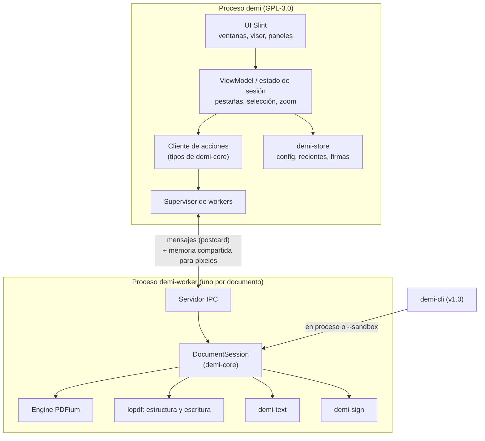
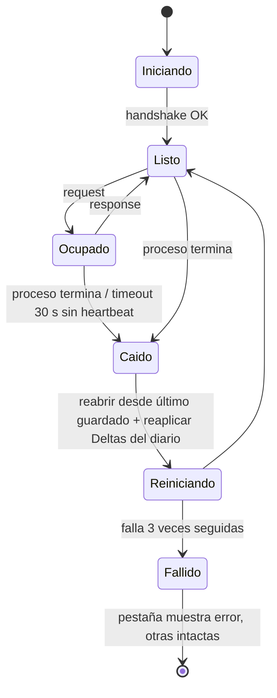
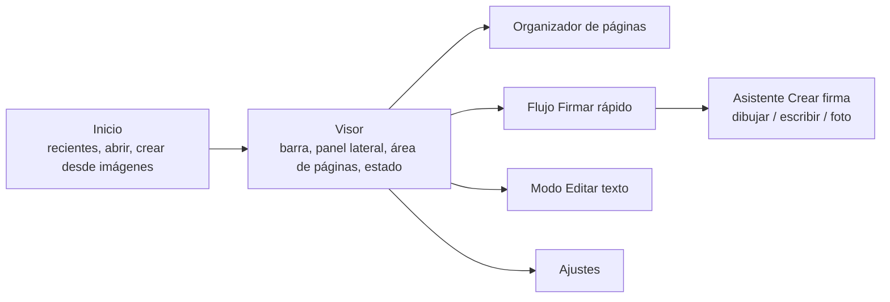
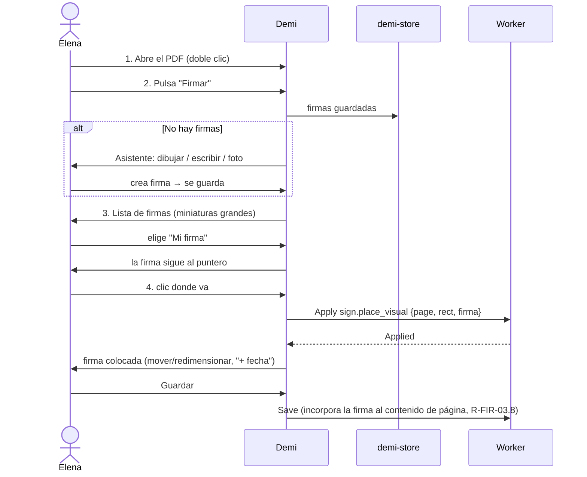
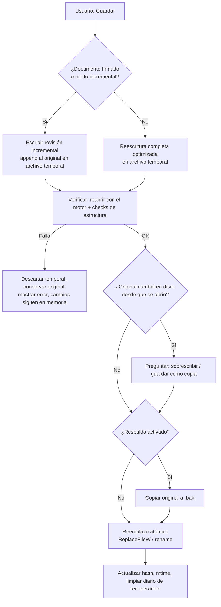

# Demi — Diseño del producto (`design.md`)

> **Spec:** 00-producto · **Fase:** 2 (Diseño) · **Estado:** propuesto para aprobación
> **Fecha:** 2026-11-15
> **Entrada:** `requirements.md` (R-*), `descubrimiento.md` (UC-*), `../research/edicion-texto-existente.md`
> **Siguiente fase:** `tasks.md`

Este documento describe **cómo** se construirá Demi para cumplir los requisitos. Las decisiones marcadas como **[Spike]** se validarán con una prueba de concepto antes de comprometer el diseño definitivo; sus criterios de éxito están en §14.

---

## 1. Decisiones de arquitectura (ADR resumidos)

| # | Decisión | Alternativas descartadas | Motivo | Requisitos |
|---|----------|--------------------------|--------|-----------|
| ADR-01 | **Rust** en todo el código propio. | C++, Electron | Seguridad de memoria. Un visor de PDF procesa entrada no confiable de forma continua. | R-NFR-SEG-01 |
| ADR-02 | **Slint** como framework de interfaz (licencia GPL-3.0, coherente con la app). | iced (sin AccessKit integrado en 0.14), Tauri (WebKitGTK inestable en Linux), egui (modo inmediato, aspecto menos nativo) | Accesibilidad vía AccessKit, DSL declarativo apto para un estilo editorial propio, rendimiento nativo. | R-UI-01, R-UI-02 |
| ADR-03 | **PDFium** (`pdfium-render`) como motor principal de render, texto, formularios y anotaciones. | MuPDF (AGPL), solo Rust puro (`hayro`, inmaduro para edición/formularios) | Es el motor más compatible y de licencia permisiva. | R-VIS-*, R-FOR-*, R-ANO-* |
| ADR-04 | **`lopdf`** para manipular la estructura (páginas, objetos, guardado incremental, parches de content stream). | Usar solo PDFium para todo | Control fino y en Rust de la escritura; permite la edición N1 "quirúrgica" y la firma incremental. | R-PAG-*, R-EDI-03, R-FIR-04 |
| ADR-05 | **Proceso aislado `demi-worker`** desde el MVP: el único proceso que abre PDFs. Un worker por documento abierto (con límite). | Todo en un solo proceso | PDFium está escrito en C++. Si un PDF malicioso provoca un fallo de memoria, se contiene en el worker y la app sigue viva. Añadirlo más tarde obligaría a reescribir mucho. | R-SEG-05, R-NFR-SEG-01 |
| ADR-06 | **Catálogo de acciones** (`Action`) en `demi-core` como única vía para modificar documentos; lo comparten la UI, la CLI y los futuros plugins. | Lógica en la UI | Una sola implementación, deshacer uniforme, CLI y plugins sin duplicar código. | R-SIS-04, R-LOT-01, R-EDI-01 |
| ADR-07 | **`hayro`** como segundo renderizador **solo en pruebas** (doble render y comparación SSIM). Candidato a motor alternativo a futuro. | — | Detecta errores del motor principal y de la regeneración de contenido. | R-EDI-03.6, R-NFR-CAL-04 |
| ADR-08 | Licencias: crates de biblioteca **MIT OR Apache-2.0**; binarios `demi` y `demi-cli` **GPL-3.0**. | — | Decisión del producto. | R-NFR-CAL-01/02 |
| ADR-09 | Traducciones con el sistema de Slint (`@tr`, catálogos gettext `.po`). | Fluent | Integración nativa con el DSL y las herramientas de Slint. | R-UI-03 |
| ADR-10 | Datos locales: configuración en TOML; recientes, estado de lectura y firmas guardadas (cifradas) en SQLite (`rusqlite`, *bundled*). Secretos en el almacén del sistema (`keyring`). | Archivos JSON sueltos | Consultas, migraciones y escritura atómica sencillas. | R-VIS-04, R-NAV-06, R-FIR-02 |

---

## 2. Vista general

### 2.1 Workspace de Cargo

```
demi/
├─ Cargo.toml                    # workspace
├─ crates/
│  ├─ demi-core/                 # MIT/Apache · modelo, acciones, operaciones, deshacer, guardado
│  ├─ demi-engine/               # MIT/Apache · trait Engine + impl PDFium (feature "pdfium") + hayro (tests)
│  ├─ demi-text/                 # MIT/Apache · bloques de texto, edición N0/N1/N2, fuentes, shaping
│  ├─ demi-sign/                 # MIT/Apache · firmas visuales, PAdES, validación
│  ├─ demi-ipc/                  # MIT/Apache · protocolo app↔worker, framing, memoria compartida
│  ├─ demi-worker/               # MIT/Apache (bin) · bucle del worker aislado
│  ├─ demi-store/                # MIT/Apache · configuración, SQLite, keyring, recuperación
│  ├─ demi-app/                  # GPL-3.0 (bin "demi") · UI Slint
│  └─ demi-cli/                  # GPL-3.0 (bin "demi-cli") · v1.0
├─ ui/                           # archivos .slint: tokens, componentes, ventanas
├─ i18n/                         # es.po, en.po
├─ assets/                       # iconos, fuentes OFL, sellos
├─ corpus/                       # PDFs de prueba (submódulo / descarga)
├─ xtask/                        # tareas: descargar PDFium fijado, empaquetar, corpus
└─ specs/                        # este directorio
```

### 2.2 Componentes y procesos



**Reglas de dependencia:**
- `demi-app` **no** enlaza PDFium ni `lopdf`: solo `demi-core` (tipos y acciones), `demi-ipc` y `demi-store`.
- `demi-core` no depende de Slint ni de ninguna UI (R-NFR-CAL-01).
- El acceso a red solo existe en `demi-sign` (TSA/OCSP) y en el comprobador de actualizaciones, y siempre por acción explícita (R-SIS-02).

---

## 3. Modelo de dominio (`demi-core`)

### 3.1 Tipos principales

```rust
/// Identificador estable de un documento abierto en la sesión.
pub struct DocId(u64);
/// Índice de página (0-based) dentro del documento actual.
pub struct PageIndex(u32);
/// Rectángulo en unidades PDF (puntos, origen abajo-izquierda), por página.
pub struct PdfRect { pub x0: f32, pub y0: f32, pub x1: f32, pub y1: f32 }

pub struct DocumentInfo {
    pub page_count: u32,
    pub pdf_version: String,
    pub encrypted: Encryption,
    pub has_javascript: bool,
    pub has_attachments: bool,
    pub has_forms: FormKind,              // None | AcroForm | Xfa | Hybrid
    pub signatures: Vec<SignatureSummary>,
    pub repaired: bool,                   // R-VIS-06
    pub content_hash: [u8; 32],           // R-VIS-04.3 (BLAKE3)
}

pub struct PageInfo { pub size: (f32, f32), pub rotation: Rotation, pub label: Option<String> }
```

### 3.2 Catálogo de acciones (ADR-06)

Toda modificación de un documento es una `Action`: serializable, validable y reversible.

```rust
pub trait Action: Serialize + DeserializeOwned + Send + 'static {
    /// Nombre estable, p. ej. "pages.rotate". Lo usan la CLI, la paleta de comandos y los plugins.
    const ID: &'static str;
    type Output: Serialize + DeserializeOwned;

    /// Validación previa (rangos, permisos, firmas presentes...). Sin efectos.
    fn validate(&self, doc: &DocumentSession) -> Result<Preflight, ActionError>;
    /// Aplica la acción y devuelve un Delta para deshacer.
    fn apply(&self, doc: &mut DocumentSession, ctx: &mut ActionCtx) -> Result<(Self::Output, Delta), ActionError>;
}

/// Advertencias que la UI debe mostrar antes de confirmar (p. ej. "invalida la firma").
pub struct Preflight { pub warnings: Vec<Warning>, pub requires_confirmation: bool }

pub enum Warning {
    InvalidatesSignatures { count: usize },   // R-EDI-03.7, R-FIR-05.6
    MissingGlyphs { chars: Vec<char> },       // R-EDI-03.4
    TextOverflow { by_pt: f32 },              // R-EDI-03.5
    StyleMayDiffer,                           // R-EDI-02.3
    XfaForm,                                  // R-FOR-04.3
}
```

**Familias de acciones (MVP en negrita):**

| Familia | Acciones |
|---------|----------|
| `pages.*` | **rotate, delete, duplicate, insert_blank, insert_from, move, extract, merge, split**, crop (v1.0), interleave (v1.0) |
| `annot.*` | **create, update, delete, reorder**, reply/set_state (v1.0), flatten (v1.0) |
| `form.*` | **set_value, place_text, place_mark**, flatten (v1.0) |
| `text.*` | **edit_n0, edit_n1**, edit_n2 (v1.0), add_text (v1.0) |
| `sign.*` | **place_visual**, sign_pades (v1.0), add_signature_field (v1.0) |
| `doc.*` | set_metadata (v1.0), watermark (v1.0), number_pages (v1.0), compress (v1.0), encrypt/decrypt (v1.0), sanitize (v1.0), redact (v1.0), ocr (v1.0) |
| `create.*` | **from_images**, blank (v1.0) |

### 3.3 Deshacer/rehacer (R-EDI-01)

- Cada `apply` devuelve un `Delta` con el **antes y el después de los objetos PDF tocados** (por número de objeto y generación), más los cambios en el árbol de páginas.
- `UndoStack` guarda los `Delta` en memoria, con un límite de memoria configurable (por defecto 256 MB). Al superarlo, los más antiguos se vuelcan a un archivo temporal **cifrado** en el directorio de recuperación.
- Deshacer reaplica el "antes"; rehacer, el "después". El estado del motor PDFium se recarga desde los objetos afectados (o desde el documento entero, si la acción cambió el árbol de páginas).
- Guardar no vacía la pila (R-EDI-01.2): el documento en disco es solo una instantánea más.

### 3.4 `DocumentSession` (vive en el worker)

```rust
pub struct DocumentSession {
    source: SourceFile,          // ruta, mtime, hash al abrir (R-NFR-FIA-04)
    lo: lopdf::Document,         // estructura editable: fuente de verdad para escribir
    engine: Box<dyn Engine>,     // vista de render/texto, sincronizada tras cada Delta
    undo: UndoStack,
    dirty: bool,
    signed_revisions: Vec<ByteRange>, // para forzar guardado incremental
}
```

**Fuente de verdad:** `lopdf` mantiene el documento editable. PDFium se usa para leer, renderizar y generar contenido (apariencias, texto), y sus resultados se vuelcan al modelo `lopdf`. Tras cada acción, el motor se resincroniza: recarga incremental de objetos o recarga completa en memoria.

**[Spike S3 · confirmado]** Recarga completa en memoria tras cada acción: < 9 ms hasta la página visible en un PDF de 1 000 páginas (objetivo 200 ms). Las ediciones se acumulan como secciones incrementales cuando es posible (~0,5 ms y unos cientos de bytes por acción, frente a ~30 ms del guardado completo con PDFium). Detalle en `spikes/s3-fuente-verdad.md`.

---

## 4. Motor (`demi-engine`)

```rust
pub trait Engine: Send {
    fn open(bytes: SharedBytes, password: Option<&SecretString>) -> Result<Self, OpenError> where Self: Sized;
    fn info(&self) -> DocumentInfo;
    fn page_info(&self, p: PageIndex) -> PageInfo;

    /// Renderiza un recorte de página a escala dada en un búfer RGBA premultiplicado.
    fn render_tile(&self, req: &TileRequest, out: &mut [u8]) -> Result<(), RenderError>;

    fn text_page(&self, p: PageIndex) -> Result<TextPage, EngineError>;          // caracteres, cajas, unicode
    fn search(&self, q: &SearchQuery, sink: &mut dyn FnMut(SearchHit)) -> Result<(), EngineError>;
    fn annotations(&self, p: PageIndex) -> Result<Vec<Annotation>, EngineError>;
    fn form_fields(&self) -> Result<Vec<FormField>, EngineError>;
    fn outline(&self) -> Result<Vec<OutlineItem>, EngineError>;

    /// Genera el flujo de apariencia de una anotación o campo (R-ANO-04, R-FOR-02).
    fn build_appearance(&mut self, target: AppearanceTarget) -> Result<AppearanceStream, EngineError>;
}

pub struct TileRequest { pub page: PageIndex, pub scale: f32, pub rect_px: IRect,
                         pub annots: bool, pub forms: bool, pub color_mode: ColorMode }
```

- **`PdfiumEngine`:** usa la biblioteca PDFium enlazada dinámicamente, fijada por versión y checksum en `xtask` desde `bblanchon/pdfium-binaries`. Se actualiza al menos cada trimestre (R-NFR-SEG-03).
- **JavaScript desactivado:** no se inicializa el entorno de formularios con JS. Las acciones `Launch`, `SubmitForm`, `ImportData` y `JavaScript` se ignoran o se muestran al usuario como información (R-SEG-01).
- **`HayroEngine` (`cfg(test)` / feature `hayro`):** implementa solo `render_tile` y se usa para el doble render en pruebas (ADR-07).
- PDFium no es seguro entre hilos: **cada worker tiene un único hilo de motor** y una cola con prioridades. Hay paralelismo entre documentos porque cada uno vive en su propio worker.

### 4.1 Pipeline de render (R-VIS-02, R-NFR-REN-02/03/04)

```mermaid
sequenceDiagram
    participant UI as UI (Slint)
    participant VM as Visor (app)
    participant C as Caché de teselas (app)
    participant W as Worker
    UI->>VM: scroll / zoom (viewport)
    VM->>C: ¿teselas visibles a escala s?
    C-->>VM: aciertos + faltantes
    VM->>UI: dibuja aciertos; faltantes = versión escalada o marcador
    VM->>W: RenderTiles{tiles, prioridad=visibles>vecinas, gen=n}
    W->>W: cancela peticiones con gen < n
    W-->>VM: TileReady{id, shm_slot}
    VM->>C: inserta (LRU, límite 512 MB)
    VM->>UI: invalida región
```

- **Teselas** de 512×512 px a escalas cuantizadas (×1, ×1,5, ×2, ×3…, multiplicadas por el DPI del monitor). Mientras el usuario hace zoom se muestra la escala más cercana disponible, y la exacta se pide con prioridad (R-VIS-02.3).
- **Prioridades:** teselas visibles > página siguiente/anterior > miniaturas > búsqueda en segundo plano.
- **Cancelación por generación:** cada cambio de viewport incrementa `gen`, y el worker descarta el trabajo pendiente obsoleto (R-NFR-REN-03).
- **Colores de lectura** (sepia, invertido inteligente, alto contraste) se aplican en la app con un shader o paso de imagen sobre la tesela, **nunca** en el worker ni en el archivo (R-VIS-09.3). El "invertido inteligente" usa las cajas de imagen que reporta el motor para no invertirlas.

---

## 5. Comunicación app ↔ worker (`demi-ipc`)

### 5.1 Transporte

- **Canal de control:** socket local (named pipe en Windows, socket de dominio Unix en macOS/Linux) mediante el crate `interprocess`. Mensajes con prefijo de longitud, serializados con `postcard` (serde).
- **Píxeles:** un **anillo de memoria compartida** por worker (N ranuras de 512×512×4 bytes) creado por la app. El worker escribe en una ranura y avisa por el canal de control. Los píxeles no pasan por el socket. **[Spike S2]**
- El worker se lanza con un token aleatorio de un solo uso y solo acepta la conexión que lo presente.

### 5.2 Mensajes (resumen)

```rust
pub enum Request {
    Open { file: FileHandle, password: Option<SecretString> },
    Info, PageInfo(PageIndex), Outline, TextPage(PageIndex),
    RenderTiles { gen: u64, tiles: Vec<TileRequest> },
    Search { id: u64, query: SearchQuery }, CancelSearch(u64),
    Preflight { action: ActionEnvelope },
    Apply { action: ActionEnvelope },         // ActionEnvelope = { id: &'static str, payload: Vec<u8> }
    Undo, Redo,
    Save { target: SaveTarget, mode: SaveMode },
    Shutdown,
}
pub enum Response {
    Opened(DocumentInfo), TileReady { gen: u64, tile: TileId, slot: u16 },
    SearchHit { id: u64, hit: SearchHit }, SearchDone(u64),
    Preflight(Preflight), Applied { output: Vec<u8>, changed_pages: Vec<PageIndex> },
    Saved(SaveReport), Error(ErrorReport), Progress { op: u64, done: u32, total: u32 },
}
```

- **`FileHandle`:** la app abre el archivo y pasa al worker el descriptor o handle heredado, o en su defecto los bytes por memoria compartida. Así el worker no necesita permisos de sistema de archivos (base para restringirlo en v1.0).
- **Errores:** `ErrorReport` lleva un código estable y un mensaje traducible; nunca contiene contenido del documento ni contraseñas (R-NFR-SEG-02).

### 5.3 Supervisión y recuperación (R-SEG-05)



- La app guarda un **diario de acciones** por documento (acciones aplicadas desde el último guardado), cifrado en el directorio de recuperación. Si el worker cae, se reabre el archivo y se reaplica el diario. Este mismo mecanismo cubre la recuperación tras un cierre inesperado (R-SIS-03).
- Límite por defecto de 8 workers simultáneos. Las pestañas inactivas que superen el límite liberan su worker y lo recrean al volver.

### 5.4 Endurecimiento del worker

| Medida | MVP | v1.0 |
|--------|-----|------|
| Proceso separado, sin red (no enlaza código de red) | ✓ | ✓ |
| Windows: Job Object (kill-on-close, límite de memoria) | ✓ | ✓ |
| Windows: token de integridad baja / AppContainer | — | ✓ |
| Linux: Landlock (sin acceso a FS) + seccomp | — | ✓ |
| macOS: perfil de sandbox para el ejecutable del worker | — | ✓ |
| Límite de memoria y tiempo por operación | ✓ | ✓ |

---

## 6. Interfaz (`demi-app`, Slint)

### 6.1 Estructura de ventanas



**Layout del visor:**

| Zona | Contenido |
|------|-----------|
| Barra superior (`chrome`) | Marca Demi, pestañas, botones: Abrir, **Firmar** (primario), Anotar, Organizar, Editar texto, Buscar, menú |
| Panel lateral izquierdo (plegable) | Miniaturas · Marcadores · Anotaciones · (v1.0) Firmas, Adjuntos |
| Área central (`canvas`) | Páginas (`paper`) con capa de anotaciones y capa de interacción |
| Barra de herramientas contextual | Aparece según el modo: colores de resaltado, grosor, fuente… |
| Barra de estado | Página n de N, zoom, indicadores de seguridad (JS, adjuntos, formularios, firmas), avisos |

### 6.2 Componente central `PageView` **[Spike S1]**

- Componente Slint propio con un modelo de páginas virtualizado: solo se crean los elementos de las páginas visibles ± 1.
- Cada página se compone de una `Image` por tesela (búfer RGBA de la caché como `slint::Image` desde `SharedPixelBuffer`), una **capa de anotaciones vectoriales** dibujada en Slint (`Path`, `Rectangle`) para editar con fluidez sin re-renderizar en PDFium, y una **capa de interacción** (selección de texto, manejadores, puntos de inserción).
- Mientras se edita una anotación, se dibuja en Slint. Al soltarla, se aplica la acción y la tesela se regenera con la apariencia real.
- **Accesibilidad del documento:** cada página expone en AccessKit un nodo con su texto extraído en orden de lectura, para que los lectores de pantalla puedan leer el contenido (R-UI-02.3). Si el PDF está etiquetado, se respeta su estructura.

### 6.3 Modos de interacción

Máquina de estados de la herramienta activa: `Mano`, `Seleccionar texto`, `Resaltar` / `Subrayar` / `Tachar`, `Nota`, `Texto libre`, `Dibujo` (v1.0), `Forma` (v1.0), `Colocar firma`, `Colocar marca`, `Editar texto`, `Redactar` (v1.0). `Esc` siempre vuelve a `Seleccionar texto`.

### 6.4 Flujo "Firmar rápido" (R-FIR-03, objetivo O-1)



### 6.5 Atajos principales (R-UI-04)

| Acción | Windows/Linux | macOS |
|--------|---------------|-------|
| Abrir / Guardar / Guardar como | Ctrl+O / Ctrl+S / Ctrl+Shift+S | ⌘O / ⌘S / ⌘⇧S |
| Buscar | Ctrl+F | ⌘F |
| Paleta de comandos (v1.0) | Ctrl+K | ⌘K |
| Deshacer / Rehacer | Ctrl+Z / Ctrl+Shift+Z | ⌘Z / ⌘⇧Z |
| Firmar | Ctrl+Shift+F | ⌘⇧F |
| Resaltar / Nota / Texto | H / N / T | H / N / T |
| Zoom ajustar ancho / página / 100 % | Ctrl+2 / Ctrl+1 / Ctrl+0 | ⌘2 / ⌘1 / ⌘0 |
| Atrás / Adelante | Alt+← / Alt+→ | ⌘[ / ⌘] |

---

## 7. Edición de texto existente (`demi-text`)

Basado en `../research/edicion-texto-existente.md`.

### 7.1 Modelo de bloques

```rust
pub struct TextBlock {
    pub id: BlockId,
    pub page: PageIndex,
    pub bbox: PdfRect,
    pub lines: Vec<TextLine>,
    pub editable: Editability,   // N1 | OnlyN0 { reason } | NotEditable { reason }
}
pub struct TextLine { pub runs: Vec<TextRun>, pub baseline: f32 }
pub struct TextRun {
    pub text: String,                  // unicode (vía ToUnicode)
    pub glyphs: Vec<GlyphRef>,         // código de carácter + posición + ancho
    pub font: FontRef,                 // recurso de fuente, subset?, tipo, fsType
    pub size: f32, pub fill: Color, pub matrix: Matrix,
    pub source: ContentLocation,       // objeto de content stream + rango de operadores
}
```

- Los bloques se construyen con la API de texto de PDFium (caracteres, cajas, objeto de texto de cada carácter) y se agrupan en líneas y bloques con heurísticas geométricas (líneas base, interlineado, alineación).
- `Editability` explica **por qué** algo no es editable (Type3, texto como contorno, imagen, RTL o vertical), y la UI lo muestra (R-EDI-03.8).

### 7.2 Algoritmos por nivel

| Nivel | Pasos | Crates |
|-------|-------|--------|
| **N0** (MVP) | 1) Localizar los operadores de los glifos dentro de la zona. 2) Eliminarlos del content stream (dividiendo `TJ` si hace falta). 3) Emitir texto nuevo con fuente estándar o incrustada. 4) Verificar que el texto antiguo ya no se extrae. | `lopdf`, `krilla`/`pdf-writer` para emitir, `subsetter` |
| **N1** (MVP) | 1) Comprobar la cobertura de glifos en la fuente incrustada (cmap/ToUnicode inverso). 2) Calcular el ancho nuevo con las métricas (`/Widths`). 3) **Vía A (prototipo):** `FPDFText_SetText` + `FPDFPage_GenerateContent`. **Vía B (objetivo):** parche quirúrgico de los operadores `Tj`/`TJ` afectados con `lopdf`, sin regenerar la página. 4) Validar con doble render y SSIM con máscara ≥ 0,999 y round-trip de extracción. | `pdfium-render`, `lopdf`, `skrifa` |
| **N2** (v1.0) | Elegir la sustituta (mismo nombre en el sistema si `fsType` lo permite → Liberation/Carlito/Caladea/Croscore → Noto), hacer shaping, subset, incrustar como Type0/Identity-H y mostrar vista previa. | `harfrust`, `skrifa`, `subsetter`, `fontdb` |
| **N3** (posterior) | Detectar el párrafo, recomponerlo con `parley` y reemitir sus líneas como `TJ`, conservando el etiquetado. | `parley` |

**Regla:** si la vía B no puede garantizar el resultado, se usa la vía A. Si la validación falla, se ofrece N0. Nunca se guarda una edición que no pase la validación sin que el usuario lo confirme explícitamente.

---

## 8. Firmas (`demi-sign`)

### 8.1 Firma visual (MVP)

- **Dibujo:** trazos capturados como polilíneas con presión opcional, suavizados (Catmull-Rom). Se guardan como vectores y se exportan a imagen con transparencia.
- **Texto manuscrito:** 2 o 3 tipografías script con licencia OFL incluidas.
- **Desde foto (R-FIR-01.2):**
  1. Corregir la orientación EXIF.
  2. Convertir a escala de grises.
  3. Normalizar la iluminación (sustraer el fondo estimado con un desenfoque grande).
  4. Umbral de Otsu para separar tinta y papel.
  5. Limpiar el ruido con morfología (apertura).
  6. Recortar a la caja de la tinta más un margen.
  7. Calcular el alfa a partir de la luminancia, para conservar bordes suaves.
  8. Recolorear al color de tinta elegido.

  La vista previa permite ajustar el umbral con un deslizador. Crates: `image`, `imageproc`.
- **Almacenamiento:** tabla `signatures` en SQLite con la imagen (PNG) y los vectores **cifrados con AES-256-GCM**. La clave se guarda en el almacén del sistema vía `keyring` (DPAPI/Credential Manager, Llavero, Secret Service). Si en Linux no hay Secret Service, se pide una contraseña local.
- **Al guardar el documento**, la firma visual se convierte en un XObject de imagen dibujado en el content stream de la página. No queda como anotación (R-FIR-03.8).

### 8.2 Firma digital PAdES (v1.0) **[Spike S4]**

- Se carga el `.p12/.pfx` y se construye la estructura CMS/PKCS#7 *detached* (`SubFilter /ETSI.CAdES.detached`) sobre el `ByteRange`. El documento se escribe con **guardado incremental**: placeholder de `/Contents`, cálculo del hash y relleno del hueco.
- B-T: sello de tiempo RFC 3161 a la TSA configurada, solo con red y acción explícita.
- Crates candidatos (por validar en el spike): RustCrypto (`cms`, `x509-cert`, `der`, `rsa`, `p256`/`p384`, `sha2`) y un lector PKCS#12 en Rust puro. Si la madurez no basta, se evaluará `openssl` como dependencia opcional con licencia compatible.
- **Validación (R-FIR-05):** comprobar el `ByteRange`, verificar el CMS, construir la cadena contra el almacén de confianza del sistema (`rustls-native-certs` o equivalente) y opcionalmente consultar OCSP/CRL. El resultado tiene tres estados: Válida, Válida con advertencias o Inválida, cada uno con icono, texto y color (R-UI-02.5).

### 8.3 Preparar para firmar (v1.0)

Se crean campos `/FT /Sig` estándar con nombre del firmante esperado (`/TU`). Al abrir un documento con campos de firma vacíos, se activa el asistente "Firma aquí · 1 de N" (R-FIR-06).

---

## 9. Guardado e integridad



- El archivo temporal se crea en el **mismo directorio** que el destino para que el reemplazo sea atómico (R-NFR-FIA-01). En Windows se usa `ReplaceFileW` y en Unix `rename(2)` + `fsync` del directorio.
- Si hay disco lleno o falta de permisos, se informa y se conservan el original y los cambios en memoria (R-NFR-FIA-05).
- El diario de recuperación se escribe cada ≤ 60 s y en cada acción (R-SIS-03.2).

---

## 10. Persistencia local (`demi-store`)

| Dato | Ubicación | Formato |
|------|-----------|---------|
| Configuración | `{config_dir}/demi/config.toml` | TOML |
| Recientes, estado de lectura (por `content_hash` + ruta) | `{data_dir}/demi/demi.db` | SQLite |
| Firmas guardadas | `demi.db` tabla `signatures` (cifrado) + clave en `keyring` | AES-256-GCM |
| Diario de recuperación | `{cache_dir}/demi/recovery/` | postcard cifrado |
| Caché de miniaturas de recientes | `{cache_dir}/demi/thumbs/` | WebP |

Los directorios salen del crate `directories`. El modo portátil (posterior) los coloca junto al ejecutable.

---

## 11. Sistema de diseño

### 11.1 Principios

1. **Papel sobre escritorio:** el documento (`paper`) es lo más claro. Todo lo demás es un escritorio salvia que se queda en segundo plano.
2. **Tinta, no negro:** el texto usa `ink` (#204243) y la acción principal `accent` (#2B5E62). Los oscuros aparecen como trazo, nunca como grandes superficies en el tema claro.
3. **Un solo acento por vista.** El rosa (`rose`) marca lo que te espera: firmas pendientes y anotaciones.
4. **Calma y legibilidad:** bordes finos de 1 px, sin sombras pesadas, espacio generoso y controles amplios por defecto (modo compacto opcional).

### 11.2 Tokens de color

| Token | Claro | Oscuro | Uso |
|-------|-------|--------|-----|
| `paper` | `#FFFFFF` | `#FFFFFF`* | Hoja del documento |
| `canvas` | `#EEF4F0` | `#142A2B` | Fondo alrededor de las páginas |
| `chrome` | `#E1E4DB` | `#1B3637` | Barras y paneles |
| `surface` | `#FFFFFF` | `#204243` | Diálogos, menús, tarjetas |
| `sand` | `#E2D2C3` | `#3A3A33` | Superficies cálidas, selección suave |
| `line` | `#BEC0BB` | `#2E5052` | Bordes y separadores |
| `text` (`ink`) | `#204243` | `#EEF4F0` | Texto principal |
| `text-secondary` | `#2B5E62` | `#BEC0BB` | Texto secundario legible |
| `text-disabled` | `#92938E` | `#5F7779` | Deshabilitado (no legible a propósito) |
| `icon-muted` | `#779699` | `#93A8AD` | Iconos inactivos, bordes de controles |
| `accent` | `#2B5E62` | `#8FC3C6` | Acción principal, foco, selección, enlaces |
| `on-accent` | `#FFFFFF` | `#142A2B` | Texto sobre `accent` |
| `rose` | `#B9A1A1` | `#D9B8B8` | Firmas pendientes, marcas |
| `focus-ring` | `#2B5E62` 2 px | `#8FC3C6` 2 px | Foco visible (R-UI-02.2) |

\* En el tema oscuro la hoja se mantiene blanca por defecto. Si el usuario quiere oscurecerla, usa los modos de color de lectura (R-VIS-09).

**Contrastes verificados (WCAG 2.2):**
- Claro: `ink` sobre `paper` 10,9:1; `accent` sobre `paper` 7,3:1; texto blanco sobre `accent` 7,3:1.
- Oscuro: `#EEF4F0` sobre `canvas` 13,5:1; `accent` oscuro `#8FC3C6` sobre `canvas` 7,7:1; `#BEC0BB` sobre `canvas` 8,2:1.

`stone`, `mist`, `rose` y `icon-muted` nunca se usan para texto legible en el tema claro (R-UI-02.1).

### 11.3 Colores de anotación (resaltado)

Se aplican con mezcla *multiply* sobre la página. Todos mantienen el texto `ink` por encima de 7:1.

| Nombre | Hex | Contraste de `ink` encima |
|--------|-----|---------------------------|
| Miel | `#F3E3A1` | 8,5:1 |
| Rosa | `#E8CFCF` | 7,4:1 |
| Salvia | `#CFE3D6` | 8,1:1 |
| Niebla | `#C9D8E6` | 7,5:1 |
| Arena | `#E9D5BF` | 7,7:1 |
| Tinta (subrayado/tachado) | `#2B5E62` | — |

### 11.4 Tipografía (todas OFL, incluidas en la app)

| Rol | Fuente propuesta | Uso |
|-----|------------------|-----|
| Marca y títulos editoriales | **Newsreader** (serif, cursiva para el logotipo) | Logotipo "Demi", títulos de diálogos principales, pantalla de inicio |
| Interfaz | **Inter** | Botones, menús, paneles, barra de estado |
| Firma escrita | 2–3 script OFL (p. ej. *Caveat*, *Dancing Script*) | Asistente de firma |
| Monoespaciada | **JetBrains Mono** | Modo compacto, propiedades técnicas |

Escala de la interfaz (modo normal / compacto): 12/11 (meta) · 14/13 (cuerpo) · 16/14 (destacado) · 20/16 (títulos) · 28/22 (marca).

### 11.5 Espaciado, forma e iconos

- Espaciado en base 4: 4, 8, 12, 16, 24, 32.
- Radios: 4 px para controles, 8 px para tarjetas y diálogos, 0 para la hoja.
- Altura de control: 36 px (normal), 28 px (compacto). Área táctil mínima de 32 px.
- Iconos: **Tabler Icons** (MIT), trazo de 1,5 px, en variantes outline.
- Movimiento: transiciones de 120–200 ms; se desactivan si el sistema pide reducir el movimiento (R-UI-02.4).

### 11.6 Componentes (Slint)

`Button` (primary/secondary/ghost), `IconButton`, `Tabs`, `Toolbar`, `ContextToolbar`, `SidePanel`, `ThumbnailList`, `OutlineTree`, `AnnotationList`, `SearchBar`, `ColorSwatches`, `Dialog`, `Toast`, `StatusBar`, `SecurityBadges`, `SignaturePicker`, `SignaturePad`, `PhotoSignatureCleaner`, `PageView`, `PageGrid` (organizador), `GuidedStepper` ("Firma aquí · 1 de 3").

Los tokens viven en `ui/tokens.slint` como `global Theme`, con propiedades que cambian según el tema activo.

### 11.7 Entregables visuales asociados

**Aprobados (2026-11-15):** lienzo de diseño "Demi — Logo y pantallas clave": https://claude.ai/artifact/5QB9UgDE6LUExBwXT1ke1z

Contiene:
- Logotipo de Demi: logotipo serif cursivo y un monograma para el icono de la app.
- Pantallas: Inicio, Visor con anotaciones, Firmar rápido (selector + colocación), Asistente de firma desde foto, Organizador de páginas, Editar texto (N1 con aviso), tema oscuro.

---

## 12. Internacionalización

- Todas las cadenas de `.slint` usan `@tr("…")`. Las cadenas de Rust pasan por un módulo `i18n` con el mismo catálogo.
- Catálogos `i18n/es.po` e `i18n/en.po`. El idioma se detecta del sistema y se puede cambiar en Ajustes (R-UI-03).
- Fechas y números con la configuración regional del sistema. El formato de fecha de firma es configurable.

---

## 13. Calidad, pruebas y CI

### 13.1 Tipos de prueba

| Tipo | Qué cubre | Herramientas |
|------|-----------|--------------|
| Unitarias | Acciones, deshacer, geometría, parsers propios | `cargo test`, `proptest` |
| Regresión visual | Render de páginas del corpus vs. imágenes de referencia; doble render PDFium/hayro | SSIM (`image-compare`), umbrales por documento |
| Edición de texto | SSIM con máscara ≥ 0,999 fuera de la zona; round-trip de extracción | `demi-text` + corpus de edición |
| Integridad de salida | Cada PDF producido pasa `qpdf --check`; reabrir con PDFium y hayro | `qpdf` en CI |
| Compatibilidad | Anotaciones, formularios y firmas en Acrobat, Chrome, Firefox y Preview | pdf.js en CI (automático); Acrobat y Preview con checklist manual por versión |
| Fuzzing | Apertura, render, acciones aleatorias, IPC | `cargo-fuzz` (libFuzzer), ejecución nocturna |
| Recuperación | Matar el worker en mitad de una acción; cortes de guardado simulados | Pruebas de integración |
| Rendimiento | R-NFR-REN-01…06 en el equipo de referencia | `criterion` + script de arranque |
| Accesibilidad | Navegación con teclado, árbol AccessKit, contraste de tokens | Pruebas automáticas del árbol + revisión con NVDA, VoiceOver y Orca |
| Usabilidad | O-1: firmar en ≤ 4 pasos con ≥ 3 personas no técnicas | Sesión guiada (incluye el caso real de Elena) |

### 13.2 Corpus

Subconjuntos con licencia compatible de las suites de pdf.js y PDFBox y del corpus de hayro, más un conjunto propio de casos borde (§14 de `requirements.md`): formularios oficiales, documentos firmados, escaneos y PDFs dañados. Se descargan con `xtask corpus` y no se versionan en el repositorio si su licencia no lo permite.

### 13.3 CI (GitHub Actions)

- Matriz: `windows-latest` (x64), `macos-latest` (arm64) + macOS Intel, `ubuntu-latest` (x64).
- Pasos: `fmt`, `clippy -D warnings`, `cargo deny` (licencias y avisos de seguridad), tests, regresión visual, `qpdf --check` y artefactos de empaquetado.
- Nocturno: fuzzing, corpus completo y rendimiento.

### 13.4 Empaquetado (R-SIS-01)

| Plataforma | Formato | Herramienta |
|------------|---------|-------------|
| Windows x64/ARM64 | MSI + manifiesto winget | `cargo-packager` (o WiX) |
| macOS arm64/x64 | DMG firmado y notarizado (binario universal) | `cargo-packager` + `codesign`/`notarytool` |
| Linux x86_64 | AppImage, .deb (v1.0: .rpm, Flatpak) | `cargo-packager`, `flatpak-builder` |

PDFium se empaqueta junto al ejecutable, con versión fijada y checksum verificado en el build. Cada paquete incluye el aviso de licencias de terceros generado con `cargo about`.

---

## 14. Riesgos y spikes (primeras tareas de la Fase 3)

| Spike | Pregunta | Criterio de éxito | Plan B |
|-------|----------|-------------------|--------|
| **S1 · Visor Slint** | ¿Puede Slint mostrar páginas en teselas con zoom y scroll fluidos, una capa vectorial de anotaciones y un árbol AccessKit con el texto? | 60 fps al desplazar un PDF de 500 páginas en el equipo de referencia; NVDA y VoiceOver leen botones y texto de página. | Área central con un widget de render propio (wgpu) dentro de Slint; en último caso, reevaluar el framework antes de seguir. |
| **S2 · IPC + memoria compartida** | ¿El worker separado añade latencia perceptible? | Tesela de 512² visible en < 16 ms tras el render; arranque del worker < 150 ms. | Pasar los píxeles por el socket comprimidos con LZ4; pool de workers precalentados. |
| **S3 · Fuente de verdad** | ¿`lopdf` + resincronización de PDFium es viable en documentos grandes? | Acción típica aplicada y visible en < 200 ms en un PDF de 1 000 páginas. | PDFium como fuente de verdad y `lopdf` solo en la escritura final e incremental. |
| **S4 · PAdES en Rust** | ¿Firmar y validar PAdES B-B/B-T con crates Rust puros? | Firmas validadas como correctas por Acrobat Reader y por una herramienta independiente (p. ej. el validador DSS de la UE). | Dependencia `openssl` opcional. |
| **S5 · N1 con PDFium** | ¿`FPDFText_SetText` + `GenerateContent` conserva la página? | SSIM ≥ 0,999 fuera de la zona en el 95 % del corpus de edición; color correcto. | Ir directamente a la vía B (parche con `lopdf`). |
| **S6 · Firma desde foto** | ¿El algoritmo limpia fotos reales de celular? | ≥ 9 de 10 fotos reales aceptables sin ajuste manual. | Deslizador de umbral siempre visible y recorte manual. |

**Otros riesgos:**
- Vulnerabilidades en PDFium (C++): se mitigan con el worker aislado, actualizaciones trimestrales y fuzzing propio.
- Cambios de API en Slint, `lopdf` o `pdfium-render`: versiones fijadas y actualización planificada.
- Alcance del MVP: la edición N1 y el worker aislado son los elementos más caros. Se vigilan con los spikes antes de comprometer fechas.

---

## 15. Trazabilidad requisitos → diseño

| Requisitos | Módulos / secciones |
|------------|---------------------|
| R-VIS-01…06 | `demi-app` (§6), `demi-engine` (§4), `demi-store` (§10), recuperación (§5.3) |
| R-VIS-07…12 | `demi-app` (§6), modos de color (§4.1) |
| R-NAV-* | `Engine::outline/search/text_page` (§4), `demi-app` paneles (§6.1) |
| R-EXT-* | `Engine::text_page`, acciones `doc.export_*` (v1.0) |
| R-ANO-* | `annot.*` (§3.2), `build_appearance` (§4), capa vectorial `PageView` (§6.2), colores (§11.3) |
| R-EDI-01 | `UndoStack` (§3.3) |
| R-EDI-02…05 | `demi-text` (§7) |
| R-EDI-06/07 | `text.add_text`, `doc.*` (§3.2) |
| R-PAG-* | `pages.*` (§3.2), `PageGrid` (§11.6) |
| R-FOR-* | `form.*` (§3.2), `Engine::form_fields`, apariencias (§4) |
| R-FIR-01…03 | `demi-sign` §8.1, flujo §6.4, `demi-store` (§10) |
| R-FIR-04…07 | `demi-sign` §8.2–8.3, guardado incremental (§9) |
| R-SEG-01 | `PdfiumEngine` sin JS (§4) |
| R-SEG-02…04 | `doc.redact`, `doc.encrypt`, `doc.sanitize` (§3.2) |
| R-SEG-05 | `demi-worker`, supervisión y endurecimiento (§5.3, §5.4) |
| R-CON-*, R-OCR-*, R-IMP-* | `create.*`, `doc.ocr`, impresión vía diálogo del sistema (crate de impresión por plataforma, por definir en tareas v1.0) |
| R-LOT-* | `demi-cli` sobre el catálogo de acciones (§3.2) |
| R-UI-* | Sistema de diseño (§11), i18n (§12), AccessKit (§6.2) |
| R-SIS-* | Empaquetado (§13.4), red (§2.2), recuperación (§5.3, §9) |
| R-NFR-* | Render (§4.1), guardado (§9), CI y pruebas (§13), licencias (ADR-08) |
