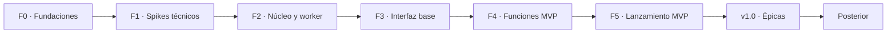

# Demi — Plan de implementación (`tasks.md`)

> **Spec:** 00-producto · **Fase:** 3 (Tareas) · **Estado:** aprobado para comenzar
> **Fecha:** 2026-11-15
> **Entrada:** `requirements.md`, `design.md`, diseños visuales: https://claude.ai/artifact/5QB9UgDE6LUExBwXT1ke1z
> **Uso:** cada tarea es una unidad de trabajo independiente (una rama / un PR). Marca `[x]` al completar.

---

## 0. Convenciones

**Estimación (esfuerzo relativo, 1 persona):**

| Talla | Esfuerzo aproximado |
|-------|---------------------|
| S | ≤ 1 día |
| M | 2–3 días |
| L | ~1 semana |
| XL | ~2 semanas (dividir si es posible) |

**Definición de terminado (aplica a TODAS las tareas):**
1. El código compila en Windows, macOS y Linux en CI.
2. `cargo fmt`, `clippy -D warnings` y `cargo deny` pasan.
3. Hay pruebas para los criterios EARS de los requisitos indicados (IDs en el nombre o en un comentario del test).
4. No hay `unwrap()` ni `expect()` en rutas que procesen datos del PDF; los errores tienen código estable.
5. Ningún texto de la interfaz está fijo en el código: todo pasa por `@tr` o i18n, en español e inglés.
6. Si la tarea toca la interfaz: navegable con teclado, foco visible y nombres accesibles.
7. `CHANGELOG.md` actualizado y documentación del crate al día.

**Puntos de control de calidad (QC)** al final de cada fase: no se avanza si su lista no está completa.

**Estrategia de spec por funcionalidad:** las funciones grandes (edición de texto, firma PAdES, redacción) pueden tener su propio spec en `specs/<nn>-<nombre>/`. Ese spec refina estas tareas sin contradecir los requisitos de producto.

---

## 1. Mapa de fases

**Camino crítico del MVP:** T0.1 → T0.3 → S1/S2/S3 → T2.1 → T2.3 → T2.4 → T3.3 → T4.x → T5.x.

---

## F0 · Fundaciones

- [x] **T0.1 Repositorio y workspace** · S
  - Crear el repo `demi` (GitHub) con licencias: `LICENSE-GPL` en la raíz, y `LICENSE-MIT` + `LICENSE-APACHE` en los crates de biblioteca. Añadir el campo `license` correcto en cada `Cargo.toml`.
  - Crear el workspace con los 9 crates vacíos de `design.md` §2.1 y los directorios `ui/`, `i18n/`, `assets/`, `xtask/`, `specs/`, más `CONTRIBUTING.md` y `SECURITY.md`.
  - **Hecho cuando:** `cargo build` pasa y `cargo deny check licenses` rechaza una dependencia AGPL de prueba.
  - Requisitos: R-NFR-CAL-01, R-NFR-CAL-02, R-NFR-CAL-03

- [x] **T0.2 CI multiplataforma** · M · depende de T0.1
  - Configurar GitHub Actions con una matriz Windows x64, macOS arm64, macOS x64 y Ubuntu x64: fmt, clippy, deny, test y caché de Cargo.
  - Añadir un workflow nocturno vacío (para fuzzing y corpus) y Dependabot o Renovate.
  - **Hecho cuando:** un PR de ejemplo muestra las cuatro plataformas en verde.
  - Requisitos: R-NFR-CAL-04, R-NFR-SEG-03

- [x] **T0.3 PDFium fijado (`xtask pdfium`)** · M · depende de T0.1
  - `xtask pdfium fetch` descarga la versión fijada de `bblanchon/pdfium-binaries` para el target actual y verifica su SHA-256. Las versiones y checksums viven en `xtask/pdfium.lock`.
  - Documentar cómo enlazarla dinámicamente para desarrollo y cómo empaquetarla.
  - **Hecho cuando:** CI descarga y verifica PDFium en las tres plataformas, y un test renderiza la página 1 de un PDF de ejemplo.
  - Requisitos: R-NFR-SEG-03, ADR-03

- [x] **T0.4 Corpus de pruebas (`xtask corpus`)** · M · depende de T0.1
  - Manifiesto `corpus/manifest.toml` con la URL, el hash, la licencia y las etiquetas de cada archivo (formulario, firmado, escaneo, dañado, grande, RTL…).
  - Subconjuntos de pdf.js, PDFBox y hayro con licencia compatible, más un set propio con los 13 casos borde de `requirements.md` §14 (generados o donados).
  - **Hecho cuando:** `xtask corpus fetch --set smoke` descarga unos 50 archivos verificados.
  - Requisitos: R-NFR-CAL-05, §14

- [ ] **T0.5 Arnés de regresión visual** · M · depende de T0.3, T0.4
  - Biblioteca de pruebas que renderiza páginas, compara contra referencias con SSIM (umbral configurable por archivo) y guarda las diferencias como artefactos de CI.
  - Comando `xtask golden update` para regenerar las referencias con revisión manual.
  - **Hecho cuando:** CI ejecuta el set `smoke` y falla si se altera una referencia.
  - Requisitos: R-NFR-CAL-04, ADR-07

**QC-F0:** CI en verde en las tres plataformas · licencias verificadas automáticamente · PDFium reproducible · corpus `smoke` disponible.

---

## F1 · Spikes técnicos (`design.md` §14)

Cada spike produce código desechable en `spikes/<nombre>/` y un informe corto en `specs/00-producto/spikes/<nombre>.md`: resultado, mediciones y decisión. **El resultado puede modificar `design.md`; si lo hace, se actualiza antes de F2.**

- [ ] **S1 Visor en Slint** · L · depende de T0.3
  - Ventana Slint que muestra un PDF de 500 páginas con teselas desde PDFium (en proceso, sin worker todavía), zoom con Ctrl+rueda, desplazamiento continuo y una capa vectorial con 50 rectángulos de "anotación" arrastrables.
  - Árbol de AccessKit: botones con nombre y un nodo de texto por página.
  - **Éxito:** 60 fps al desplazarse en el equipo de referencia; NVDA y VoiceOver anuncian los botones y leen el texto de una página.
  - **Plan B:** widget de render propio con wgpu dentro de Slint; si tampoco funciona, reevaluar ADR-02.

- [ ] **S2 IPC con memoria compartida** · M · depende de T0.3
  - Proceso worker mínimo que renderiza teselas y las entrega por un anillo de memoria compartida, con control por socket local (`interprocess` + `postcard`).
  - **Éxito:** de tesela renderizada a disponible en la app en < 16 ms; arranque del worker < 150 ms; matar el worker no afecta a la app.
  - **Plan B:** píxeles por el socket comprimidos con LZ4; pool de workers precalentados.

- [ ] **S3 Fuente de verdad del documento** · M · depende de T0.3
  - Aplicar `pages.rotate`, `annot.create` y `pages.delete` sobre un modelo `lopdf` y resincronizar PDFium (recarga incremental o completa) en PDFs de 10, 100 y 1 000 páginas.
  - **Éxito:** < 200 ms desde la acción hasta la página visible actualizada en el de 1 000 páginas.
  - **Plan B:** PDFium como fuente de verdad y `lopdf` solo al guardar.

- [ ] **S5 Edición N1 con PDFium** · M · depende de T0.3, T0.5
  - Prototipo de `FPDFText_SetText` + `FPDFPage_GenerateContent` sobre 30 PDFs del corpus de edición, con validación SSIM enmascarada y round-trip de extracción.
  - **Éxito:** ≥ 95 % de los casos con SSIM ≥ 0,999 fuera de la zona y colores correctos.
  - **Plan B:** priorizar la vía B (parche quirúrgico con `lopdf`) en T4.7.

- [ ] **S6 Firma desde foto** · S · depende de T0.1
  - Implementar el algoritmo de `design.md` §8.1 como CLI de prueba con 10 fotos reales de firmas (celular, distinta luz y papel).
  - **Éxito:** ≥ 9 de 10 resultados aceptables sin ajuste manual.
  - **Plan B:** deslizador de umbral siempre visible y recorte manual.

**QC-F1:** informes de S1, S2, S3, S5 y S6 escritos · `design.md` actualizado con las decisiones · riesgos del MVP revalidados. (S4, la firma PAdES, se ejecuta antes de las épicas de v1.0.)

---

## F2 · Núcleo y worker

- [ ] **T2.1 Tipos de dominio y catálogo de acciones** · M · depende de QC-F1
  - En `demi-core`: `DocId`, `PageIndex`, `PdfRect`, `DocumentInfo`, `PageInfo`, el trait `Action`, `Preflight`, `Warning`, `ActionError` y el `ActionRegistry` con `ActionEnvelope` (serialización por ID estable).
  - **Hecho cuando:** una acción de prueba se registra, se serializa, se deserializa y se aplica en tests.
  - Requisitos: R-SIS-04.1, ADR-06

- [ ] **T2.2 Trait `Engine` + `PdfiumEngine`** · L · depende de T2.1
  - Abrir con y sin contraseña, `info`, `page_info`, `render_tile`, `text_page`, `outline`, `annotations` y `form_fields`.
  - JavaScript desactivado; las acciones `Launch`, `SubmitForm` y `JavaScript` se ignoran.
  - Reparación al abrir y bandera `repaired`; `content_hash` con BLAKE3.
  - **Hecho cuando:** pasan los tests del corpus `smoke`; un PDF con JS de prueba no ejecuta nada; los casos dañados abren con aviso o fallan con un error tipado.
  - Requisitos: R-VIS-05, R-VIS-06, R-SEG-01, R-NFR-COM-01

- [ ] **T2.3 `DocumentSession` + `UndoStack`** · L · depende de T2.2
  - Sesión con la fuente de verdad que haya decidido S3, aplicación de acciones con `Delta`, deshacer y rehacer, límite de memoria y volcado cifrado.
  - **Hecho cuando:** una secuencia aleatoria de 1 000 acciones con deshacer y rehacer (proptest) deja el documento idéntico al original (hash de objetos).
  - Requisitos: R-EDI-01

- [ ] **T2.4 `demi-ipc` + `demi-worker` + supervisor** · L · depende de T2.3, S2
  - Protocolo de `design.md` §5.2, anillo de memoria compartida, token de conexión, heartbeat, cancelación por generación y prioridades.
  - Supervisor en la app: arranque, reinicio, límite de 8 workers y liberación de pestañas inactivas.
  - Job Object en Windows (kill-on-close y límite de memoria).
  - **Hecho cuando:** test de integración que mata el worker a mitad de un render y la app se recupera; fuzzing del decodificador de mensajes activo en el CI nocturno.
  - Requisitos: R-SEG-05.1–2, R-NFR-REN-03, R-NFR-REN-05

- [ ] **T2.5 Diario de recuperación** · M · depende de T2.4
  - Diario cifrado de acciones por documento, escrito cada ≤ 60 s y en cada acción; reaplicación tras una caída del worker o de la app.
  - **Hecho cuando:** al matar la app con cambios sin guardar y volver a abrir, se ofrece restaurarlos y el resultado es idéntico.
  - Requisitos: R-SIS-03.2–3 (adelantado al MVP por R-SEG-05.2)

- [ ] **T2.6 Guardado atómico** · L · depende de T2.3
  - "Guardar" incremental o completo, archivo temporal en el mismo directorio, verificación al reabrir, detección de cambios externos, respaldo opcional, `ReplaceFileW` / `rename` + `fsync`, y manejo de disco lleno o sin permisos.
  - **Hecho cuando:** pruebas de corte simulado (matar el proceso en cada fase del guardado) nunca dejan el original corrupto y `qpdf --check` pasa en todas las salidas.
  - Requisitos: R-NFR-FIA-01…06

- [ ] **T2.7 `demi-store`** · M · depende de T0.1
  - Configuración TOML, SQLite (recientes, estado de lectura por hash + ruta), integración con `keyring` y fallback a contraseña local en Linux sin Secret Service, cifrado AES-256-GCM y migraciones.
  - **Hecho cuando:** hay tests de migración y de cifrado, y una firma guardada no aparece en claro en ningún archivo del perfil.
  - Requisitos: R-VIS-04, R-NAV-06, R-FIR-02.2–3, R-NFR-SEG-02

**QC-F2:** la app de prueba abre, renderiza vía worker, aplica acciones con deshacer, guarda atómicamente y sobrevive a la muerte del worker · fuzzing del motor y del IPC en marcha.

---

## F3 · Interfaz base

- [ ] **T3.1 Tokens y componentes básicos en Slint** · M · depende de T0.1
  - `ui/tokens.slint` con `global Theme` (claro y oscuro, `design.md` §11.2), fuentes Newsreader, Inter y JetBrains Mono incluidas (OFL), y los componentes `Button`, `IconButton`, `Tabs`, `Toolbar`, `Dialog`, `Toast` y `StatusBar`.
  - Prueba automática de contraste de todos los pares texto/fondo de los tokens.
  - **Hecho cuando:** existe una galería de componentes (ejecutable `ui-gallery`) en ambos temas y el test de contraste pasa.
  - Requisitos: R-UI-01, R-UI-02.1, R-UI-02.4

- [ ] **T3.2 i18n** · S · depende de T3.1
  - Catálogos `es.po` y `en.po`, detección del idioma del sistema, selector en Ajustes y una verificación en CI que falla si hay cadenas sin traducir.
  - Requisitos: R-UI-03

- [ ] **T3.3 Shell de la aplicación** · L · depende de T2.4, T3.1
  - Ventana principal, pestañas (incluido enfocar un documento ya abierto), instancia única (abrir desde el sistema operativo en la instancia existente), arrastrar y soltar archivos, argumentos de línea de comandos, barra superior, barra de estado con indicadores de seguridad y diálogo de contraseña.
  - **Hecho cuando:** se cumplen los criterios de R-VIS-01 y R-VIS-05 en las tres plataformas.
  - Requisitos: R-VIS-01, R-VIS-05, R-SIS-01.3

- [ ] **T3.4 `PageView` (producción)** · XL · depende de T3.3, S1
  - Visor virtualizado con teselas, caché LRU (512 MB), escalas cuantizadas, HiDPI y cambio de monitor, modos de vista (una página, continuo, dos páginas), rotación de vista, zoom, herramienta de mano y nodos AccessKit con el texto de cada página.
  - **Hecho cuando:** se cumplen R-NFR-REN-02/03/04 en el equipo de referencia y R-VIS-02/03; un lector de pantalla lee la página.
  - Requisitos: R-VIS-02, R-VIS-03, R-UI-02.3, R-NFR-COM-03

- [ ] **T3.5 Pantalla de Inicio y recientes** · M · depende de T3.3, T2.7
  - Diseño "Inicio" del lienzo: abrir, crear desde imágenes (enlaza con T4.9), recientes con miniatura y estado, borrar historial, archivos no disponibles y restaurar la posición de lectura.
  - Requisitos: R-NAV-06, R-VIS-04

- [ ] **T3.6 Navegación** · M · depende de T3.4
  - Panel de miniaturas, árbol de marcadores con la sección actual resaltada, ir a página por número o etiqueta, historial atrás/adelante y enlaces internos y externos (con confirmación).
  - Requisitos: R-NAV-01, R-NAV-02, R-NAV-03

- [ ] **T3.7 Búsqueda** · M · depende de T3.4
  - Búsqueda en el worker con resultados parciales, resaltado y "n de N", soporte de ligaduras y guiones de corte, y aviso si no hay texto.
  - Requisitos: R-NAV-04

- [ ] **T3.8 Selección y copia de texto** · M · depende de T3.4
  - Selección siguiendo el orden de lectura, copia que une líneas y quita guiones de corte, y aviso si el mapeo Unicode no es fiable.
  - Requisitos: R-EXT-01

**QC-F3:** Demi funciona como lector diario (abrir, leer, navegar, buscar, copiar) · prueba con NVDA y VoiceOver de los flujos de lectura · rendimiento de §13 medido y registrado.

---

## F4 · Funciones MVP

- [ ] **T4.1 Anotaciones de marcado** · L · depende de T3.8, T2.3
  - Resaltar, subrayar y tachar con 6 colores, recordar el último color por herramienta, atajos H/N/T y barra contextual del diseño "Visor".
  - Apariencias `/AP` generadas por el motor.
  - Requisitos: R-ANO-01, R-ANO-04.1

- [ ] **T4.2 Notas y cuadros de texto** · M · depende de T4.1
  - Notas adhesivas con autor configurable (vacío por defecto) y fecha; cuadro de texto libre con estilo.
  - Requisitos: R-ANO-02, R-ANO-03.3

- [ ] **T4.3 Gestión de anotaciones** · M · depende de T4.2
  - Seleccionar, mover, redimensionar, recolorear y borrar, con selección múltiple; panel de anotaciones con filtros; edición sin perder datos de anotaciones ajenas.
  - **Hecho cuando:** la suite de compatibilidad (pdf.js en CI y checklist de Acrobat, Chrome, Firefox y Preview) pasa.
  - Requisitos: R-ANO-03, R-ANO-04.2–3

- [ ] **T4.4 Organizador de páginas** · L · depende de T2.3, T3.4
  - Diseño "Organizador": cuadrícula, selección por clic, Ctrl, Mayús o rangos escritos, arrastrar con indicador de inserción, girar, eliminar (redirigiendo marcadores y enlaces), duplicar, insertar en blanco o desde otro PDF o imágenes, y extraer.
  - Requisitos: R-PAG-01, R-PAG-02

- [ ] **T4.5 Unir y dividir** · M · depende de T4.4
  - Unir con una lista ordenable (marcadores agrupados por archivo, contraseñas) y dividir por rangos, cada N páginas, por marcadores o en páginas sueltas, con vista previa de nombres.
  - **Hecho cuando:** unir 100 PDFs de 10 páginas tarda ≤ 10 s.
  - Requisitos: R-PAG-03, R-PAG-04.1–2, R-NFR-REN-06

- [ ] **T4.6 Formularios** · L · depende de T3.4, T2.6
  - Rellenar campos AcroForm, Tab y Mayús+Tab, solo lectura, longitud máxima y requerido, generación de apariencias al guardar, y "llenar sin campos" (texto, ✓, ✗, punto, fecha) con ajuste magnético.
  - Requisitos: R-FOR-01, R-FOR-02, R-FOR-03

- [ ] **T4.7 Edición de texto N0 + N1** · XL · depende de S5, T2.3, T3.8
  - `demi-text`: modelo `TextBlock` con `Editability`; modo "Editar texto" del diseño; N1 por la vía que haya decidido S5; N0 con eliminación real del texto original; avisos de `Preflight` (glifos faltantes, desborde, firmas); validación SSIM y extracción antes de confirmar.
  - Puede refinarse con su propio spec `specs/01-edicion-texto/`.
  - **Hecho cuando:** el corpus de edición cumple R-EDI-03.6 y, tras N0, el texto original no aparece ni con `pdftotext` ni buscando con PDFium.
  - Requisitos: R-EDI-02, R-EDI-03

- [ ] **T4.8 Firma visual: crear y guardar** · L · depende de T2.7, T3.1, S6
  - Asistente del diseño "Crear firma": dibujar (suavizado, presión opcional), escribir (tipografías script OFL), desde foto (algoritmo de S6 con deslizador), nombre, color de tinta y almacenamiento cifrado.
  - Requisitos: R-FIR-01, R-FIR-02

- [ ] **T4.9 Firmar rápido** · L · depende de T4.8, T3.4
  - Diseño "Firmar rápido": botón Firmar siempre visible, selector de firmas, firma que sigue al puntero, colocar, mover y redimensionar con proporción, "+ fecha", iniciales en un rango de páginas, e incorporación al contenido de la página al guardar.
  - **Hecho cuando:** se mide el criterio O-1 (≤ 4 pasos) en un test de interfaz automatizado.
  - Requisitos: R-FIR-03

- [ ] **T4.10 Imágenes a PDF** · M · depende de T2.3
  - Crear un PDF desde JPG, PNG o TIFF con orden, tamaño de página, orientación, márgenes y EXIF.
  - Requisitos: R-CON-01

- [ ] **T4.11 Impresión** · M · depende de T3.4
  - Diálogo del sistema por plataforma (rango, copias, doble cara, escalado), siempre con el contenido original sin modos de color.
  - Seleccionar los crates o bindings de impresión por plataforma (decisión pendiente de `design.md`).
  - Requisitos: R-IMP-01

- [ ] **T4.12 Ajustes** · S · depende de T3.2, T2.7
  - Idioma, tema, nombre de autor, respaldo al guardar, límite de caché y lector predeterminado.
  - Requisitos: R-UI-03, R-ANO-03.3, R-NFR-FIA-03

**QC-F4:** todos los requisitos MVP de `requirements.md` §16 tienen pruebas en verde · suite de compatibilidad completa · revisión de accesibilidad de los flujos Firmar, Anotar y Organizar.

---

## F5 · Lanzamiento MVP

- [ ] **T5.1 Empaquetado y firma de binarios** · L · depende de QC-F4
  - MSI + winget, DMG universal firmado y notarizado, AppImage y .deb; PDFium incluido; asociación de archivos `.pdf`; `cargo about` para los avisos de terceros.
  - Requisitos: R-SIS-01

- [ ] **T5.2 Auditoría de privacidad y red** · S · depende de T5.1
  - Ejecutar la app bajo monitorización de red (Wireshark o Little Snitch) en los flujos MVP: cero conexiones.
  - Revisar logs y volcados en busca de contraseñas o firmas.
  - Requisitos: R-SIS-02, R-NFR-SEG-02

- [ ] **T5.3 Rendimiento final** · S · depende de T5.1
  - Medir R-NFR-REN-01…06 con los binarios empaquetados y publicar los resultados en el README.

- [ ] **T5.4 Prueba de usabilidad "Elena"** · M · depende de T5.1
  - Sesión con ≥ 3 personas no técnicas (incluida la usuaria real del caso de firma): crear una firma desde foto y firmar un documento de 3 campos.
  - Registrar pasos, tiempo y dudas, y corregir los bloqueos encontrados.
  - **Hecho cuando:** ≥ 3 de 3 completan la tarea en ≤ 4 pasos y < 30 s con la firma ya guardada.
  - Requisitos: O-1, R-FIR-03.7

- [ ] **T5.5 Documentación y lanzamiento** · M · depende de T5.2–T5.4
  - README con capturas, guía de usuario breve en español e inglés, guía de contribución, política de seguridad (reporte de vulnerabilidades), tag `v0.1.0` y release en GitHub.

**QC-F5 (MVP listo):** binarios firmados en las tres plataformas · cero tráfico de red · rendimiento dentro de objetivos · prueba Elena superada.

---

## v1.0 · Épicas (se descomponen en tareas al iniciar cada una)

| Épica | Contenido | Talla | Depende de | Requisitos |
|-------|-----------|-------|------------|-----------|
| E1 · Spike S4 + firma PAdES | Firmar con .p12 (B-B/B-T), firma visible o invisible, incremental | XL | MVP | R-FIR-04 |
| E2 · Validación de firmas | Panel, cadena, revisiones, OCSP/CRL opcional | L | E1 | R-FIR-05 |
| E3 · Preparar para firmar | Campos de firma y guía "Firma aquí · n de N" al abrir | M | E2 | R-FIR-06 |
| E4 · Edición N2 | Sustitución de fuentes, subset, vista previa | XL | T4.7 | R-EDI-04 |
| E5 · Anotación avanzada | Dibujo, formas, sellos, hilos, aplanar | L | T4.3 | R-ANO-05, R-ANO-06 |
| E6 · Contenido nuevo | Texto, imágenes, marcas de agua, numeración, metadatos | L | T2.3 | R-EDI-06 |
| E7 · Seguridad documental | Redacción real, cifrado AES-256, limpieza | XL | T2.6 | R-SEG-02…04 |
| E8 · Endurecimiento del worker | AppContainer, Landlock + seccomp, sandbox de macOS | L | T2.4 | R-SEG-05 |
| E9 · OCR local | Capa de texto, es/en, detección de páginas | L | T2.3 | R-OCR-01 |
| E10 · Visor avanzado | Pestañas a ventanas, vista dividida, lectura y presentación, modos de color, adjuntos y propiedades, recarga automática | L | T3.4 | R-VIS-07…11 |
| E11 · Búsqueda y extracción avanzadas | Opciones de búsqueda, panel, exportar texto, imágenes y notas | M | T3.7 | R-NAV-05, R-NAV-07, R-EXT-02 |
| E12 · Páginas avanzadas | Recortar, intercalar, comprimir, dividir por tamaño | L | T4.5 | R-PAG-04.3, R-PAG-05 |
| E13 · Formularios avanzados | Validación sin JS, aplanar, aviso XFA | M | T4.6 | R-FOR-04 |
| E14 · Interfaz avanzada | Modo compacto, paleta de comandos, atajos configurables, arrastrar entre ventanas, actualizaciones opt-in | L | F3 | R-UI-04, R-SIS-03 |
| E15 · CLI (Could) | `demi-cli` sobre el catálogo de acciones, `--json` | M | F2 | R-LOT-01 |
| E16 · Conversión e impresión v1.0 | PDF en blanco o desde portapapeles, imprimir anotaciones o formularios, vista previa | M | T4.11 | R-CON-02, R-IMP-02 |
| E17 · Empaquetado ampliado | .rpm, Flatpak | S | T5.1 | R-SIS-01 |

**QC-v1.0:** todos los requisitos v1.0 en verde · las firmas PAdES de Demi se validan en Acrobat Reader y en el validador DSS · auditoría de seguridad externa o comunitaria del worker y del parser.

---

## Posterior (backlog)

N3 de edición con reflujo · plugins WebAssembly con permisos · lotes y recetas · comparación de documentos · PDF/A · escaneo directo y limpieza de escaneos · PKCS#11, LT/LTA y certificación · medición, capas y multimedia · tablas a CSV · XFDF · modo portátil · `hayro` como motor alternativo.

---

## Próximo paso recomendado

1. **T0.1 → T0.3** (repositorio, CI y PDFium). Se pueden hacer en una sesión de trabajo.
2. Arrancar **S1** (visor en Slint) en cuanto T0.3 esté listo: es el riesgo más alto del proyecto.
